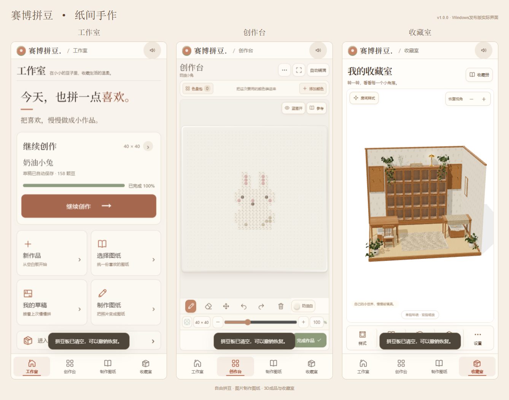
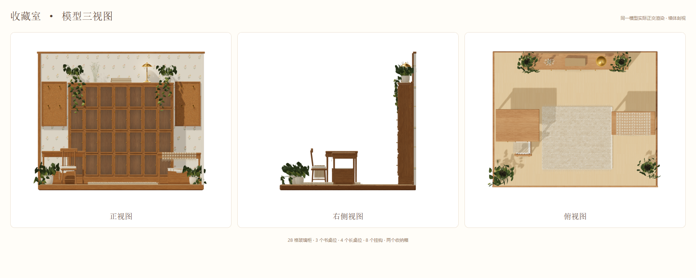

# 赛博拼豆

一款可以在电脑上摆豆、把照片转成图纸，并将完成作品放进 3D 收藏室的手作应用。

## 下载哪个能直接玩？

**Windows 用户请下载：[SaiboPindou-v1.0.0-Windows.zip](https://github.com/wangyvjie2/saibo-pindou/releases/download/v1.0.0/SaiboPindou-v1.0.0-Windows.zip)**

1. 下载后先**完整解压**压缩包。
2. 打开解压后的「赛博拼豆」文件夹。
3. 双击 **`启动赛博拼豆.exe`**，游戏会在默认浏览器中打开。

**不需要安装 Node.js、Python 或额外下载模型。** 支持 Windows 10 / 11，推荐使用 Edge 或 Chrome。

> 请保留启动器旁边的 `bead-room` 文件夹，不要只取出一个 EXE，也不要直接在压缩包内运行。
>
> Releases 中自动生成的 **Source code (zip / tar.gz)** 是开发源码，**不是免安装游戏包**。只想玩的用户下载上方的 **Windows.zip** 即可。

[所有发布版本](https://github.com/wangyvjie2/saibo-pindou/releases) · [详细使用说明](docs/使用说明.md)

## 可以做什么

- **自由拼豆**：40–300 的宽高设置，缩放与平移，放豆、取豆、覆盖保护、撤销、重做和清空确认。
- **选真实色号**：支持 MARD、ARTKAL 等现有色库，按字母与色号搜索，最多 30 色的本次色盘包。
- **照片制作图纸**：导入图片，调节图纸参数，生成并保存；可以作为板下蓝图或独立参考图。
- **完成手作流程**：检查、铺纸、熨烫、冷却、脱板，再旋转、缩放查看 3D 成品。
- **搭配配件**：十种钥匙扣、六种立牌底座，原始外观加四种配件颜色，钥匙扣支持物理摆动。
- **布置收藏室**：28 格玻璃柜、书桌 3 位、长桌 4 位、两块共 8 个挂钩的展板和两个收纳箱；墙面与地板各有 9 种样式及配色。
- **轻柔交互**：塑料落豆音效、点击反馈、全局静音和减少动态效果。

草稿、图纸和收藏主要保存在**当前电脑的浏览器本地**。不要清除浏览器网站数据；换浏览器或电脑不会自动同步。屏幕色与实物可能存在差异，实作前请核对实物色卡。

## 界面预览





预览图中的草稿为示例。网页、启动器的项目显示名称已统一为「赛博拼豆」。

## 从源码运行 / 打包

开发者可以用 Node.js 启动本地网页：

```sh
node bead-room/server.mjs
```

访问 `http://127.0.0.1:4173/`。三维库、物理库和材质文件随项目提供。

在 Windows PowerShell 中构建与打包启动器：

```powershell
powershell -ExecutionPolicy Bypass -File .\scripts\build-windows.ps1
```

输出在 `artifacts/`。构建脚本使用 Windows 的 .NET Framework C# 编译器，不需要下载编译器；普通使用者直接下载 Releases 的免安装包即可。

项目结构、启动故障处理和开发说明见 [使用说明](docs/使用说明.md)。第三方库、材质及色卡来源见 [第三方说明](THIRD_PARTY_NOTICES.md)。
